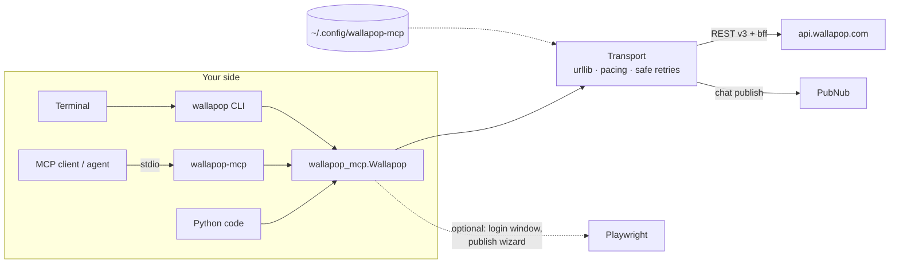

<p align="center">
  
</p>

<p align="center">
  <a href="https://github.com/figurophobia/wallapop-mcp/actions/workflows/ci.yml"></a>
  <a href="https://pypi.org/project/wallapop-mcp/"></a>
  
  
  
  <a href="LICENSE"></a>
  <a href="https://github.com/figurophobia/vinted-mcp"></a>
</p>

<p align="center">
  <b>Give an AI agent a Wallapop account.</b><br>
  Search listings, spot deals against the market median, negotiate offers, chat with buyers and sellers,
  keep saved-search alerts and manage your own listings — in pure Python over Wallapop's web API, no browser
  required for the core workflows. <b>There is no checkout or payment.</b>
</p>

---

One codebase, three interfaces:

| | What | Entry point |
|---|---|---|
| 🤖 **MCP server** | 30 tools over stdio for any MCP client; writes hidden unless you opt in | `wallapop-mcp` |
| ⌨️ **CLI** | Search, deals, offers, chat, alerts and listing management from the terminal | `wallapop` |
| 🐍 **Python library** | Typed client the other two are built on | `import wallapop_mcp` |

## Contents

- [Highlights](#highlights)
- [Install](#install)
- [Log in](#log-in)
- [Use it from an MCP client](#use-it-from-an-mcp-client)
- [MCP tools](#mcp-tools)
- [CLI](#cli)
- [Python library](#python-library)
- [How it works](#how-it-works)
- [Safety and limits](#safety-and-limits)
- [Configuration](#configuration)
- [Troubleshooting](#troubleshooting)
- [Development](#development)
- [Status and legal](#status-and-legal)

## Highlights

| Area | What you get |
|---|---|
| 🔎 **Search** | Keyword search with category / subcategory, condition, price, shipping, ordering and geography (city, region or country presets, or exact coordinates); autocomplete; the full category tree |
| 📉 **Deals** | `deals` ranks listings by discount against the median of the results, can auto-offer or message the best ones; `watch` keeps scanning |
| 🔔 **Alerts** | Saved searches (deal sniping): save, check, new-hit counter, remove |
| 📦 **Items & sellers** | Listing details, seller profile with ratings, stats, reviews and their listings |
| 💬 **Messaging** | Inbox, conversations, message a seller or reply as the seller |
| 🤝 **Offers** | Offer limits from the web's offer editor, send offers, accept / decline / counter, an offer-status dashboard per conversation |
| 🏷️ **Selling** | Publish with photos (pure API or the web wizard), edit, reserve, mark sold, pause, delete |
| 🧾 **Account** | Favorites, purchases and sales hubs |
| 🔐 **Sessions** | Email + password, a browser login window for Google accounts, Firefox import or pasted cookies; token refresh |

## Install

Python 3.10+.

```sh
pip install wallapop-mcp                  # or: uvx wallapop-mcp / pipx install wallapop-mcp
pip install 'wallapop-mcp[browser]' && playwright install chromium     # + browser login / publish wizard
```

Prefer no Python at all? Download the standalone `wallapop-mcp` / `wallapop` executables (Linux, macOS,
Windows; built with PyInstaller) from the [releases page](https://github.com/figurophobia/wallapop-mcp/releases).

## Log in

The MCP server never logs in by itself; create a session once with the CLI.

| Method | Command | Best for |
|---|---|---|
| **Auto** | `wallapop login` | Uses whatever is available: a stored session, a Firefox session, the browser window, or suggests email login |
| Email + password | `wallapop login you@mail.com` (prompts) | Regular accounts. Google accounts have no Wallapop password. |
| Browser window | `wallapop login --wizard [--timeout 600]` | **Google accounts** or any browser-only session |
| Firefox import | `wallapop login --browser firefox` | Already logged in on Firefox |
| Pasted cookies | `wallapop login --cookies-file cookies.txt` or `--cookies '…'` | Any browser or Windows (copy the `Cookie:` header from DevTools; see `cookies.txt.example`) |
| Environment | `WALLAPOP_ACCESS_TOKEN` (+ `WALLAPOP_REFRESH_TOKEN`) | Headless agents |

```sh
wallapop session     # offline: source and token expiry
wallapop logout      # delete the stored credentials
```

Credentials live in `~/.config/wallapop-mcp/` (override with `WALLAPOP_CONFIG_DIR`), outside any repository.
Never paste them into prompts or issues.

## Use it from an MCP client

```json
{
  "mcpServers": {
    "wallapop": {
      "command": "wallapop-mcp",
      "args": ["--allow-writes"]
    }
  }
}
```

OpenCode (`~/.config/opencode/opencode.json`):

```json
{
  "mcp": {
    "wallapop": { "type": "local", "command": ["wallapop-mcp", "--allow-writes"], "enabled": true }
  }
}
```

| Flag / variable | Effect |
|---|---|
| `--allow-writes` | Registers the write tools. Without it the server is read-only. |
| `--session <dir\|file>` | Session file or config directory (default `~/.config/wallapop-mcp`) |
| `WALLAPOP_ACCESS_TOKEN` / `WALLAPOP_REFRESH_TOKEN` | Use these tokens instead of a session file |

Reads (search, suggestions, item details, sellers, categories) work **without an account**. Inbox, offers,
favorites, purchases/sales, saved searches and every write need a session.

## MCP tools

30 tools. Required arguments are listed; everything else is optional. Item arguments accept an internal id,
a web slug or a full URL.

#### Read (17)

| Tool | Required args | What it does |
|---|---|---|
| `session_status` | — | Inspect local authentication status and whether writes are enabled |
| `search` | `keywords` | Search listings with bounded pages and compact results |
| `get_item` | `item_id` | Get the details of one listing |
| `get_seller` | `user_id` | Get a seller profile and aggregated ratings, optionally recent reviews |
| `list_categories` | — | Get the search category tree |
| `list_inbox` | — | Read a bounded inbox page for the signed-in account |
| `get_conversation` | `conversation_id` | Read a conversation and its available messages |
| `unread_count` | — | Get the number of unread messages |
| `list_purchases` | — | Read ongoing or finished purchases |
| `list_sales` | — | Read ongoing or finished sales |
| `get_offer_constraints` | `item_id` | Read offer limits for a listing |
| `get_offer_status` | `conversation_id` | Read offer events from a conversation |
| `seller_items` | `user_id` | List a seller's published listings (their profile grid) |
| `suggest` | `keyword` | Autocomplete suggestions for a search keyword, as the web search box shows them |
| `list_favorites` | — | List the listings the signed-in account has favorited |
| `saved_search_hits` | — | Total new listings across the account's saved searches (the web's badge counter) |
| `check_saved_search` | `keywords` | Check whether a search with exactly these filters is saved; returns its id or null |

#### Write (13)

| Tool | Required args | What it does |
|---|---|---|
| `set_favorite` | `item_id`, `favorited` | Set whether a listing is a favorite |
| `send_message` | `message` | Message a seller (item_id), or reply as the seller in an existing conversation (conversation_id) |
| `send_offer` | `item_id`, `amount` | Send a purchase offer |
| `respond_offer` | `offer_id`, `action` | Accept or decline an offer |
| `counter_offer` | `offer_id`, `amount` | Propose a new amount on an open offer |
| `publish_item` | `title`, `description`, `price`, `category_leaf_id`, `condition`, `photo_paths` | Publish a listing |
| `edit_item` | `item_id` | Update only supplied listing fields, preserving other attributes |
| `reserve_item` | `item_id`, `reserved` | Set reservation state on an owned listing |
| `mark_sold` | `item_id`, `sold` | Set sold state on an owned listing |
| `pause_item` | `item_id` | Pause (inactivate) an owned listing: hidden from the marketplace, kept in your catalog |
| `delete_item` | `item_id` | Permanently delete an owned listing |
| `save_search` | `keywords` | Save a search (alert) so Wallapop notifies new matching listings |
| `remove_saved_search` | `search_id` | Delete a saved search by id |
Names match [vinted-mcp](https://github.com/figurophobia/vinted-mcp) wherever the concept is the same, so an
agent can drive both marketplaces with the same vocabulary. Agent flows (buy & negotiate, sell) are described
step by step in [AGENTS.md](AGENTS.md).

## CLI

<details open>
<summary><b>Search, deals and alerts</b></summary>

```sh
wallapop search "nintendo switch" --city madrid --max-price 200 --order price_asc --min-price 1
wallapop search "ps5" --subcat 10088 --condition as_good_as_new,good --ship-only --pages 2 --json
wallapop suggest "nintendo sw"
wallapop deals "nintendo 3ds" --city galicia --min-discount 0.2 --top 10
wallapop deals "nintendo ds" --offer-pct 0.8 --msg "Hi! Would you sell it for {offer}?" --dry-run
wallapop watch "steam deck" --max-price 300 --interval 600
wallapop alert save "switch 2" --max-price 300 | alert check "switch 2" --max-price 300 | alert hits | alert remove --id <uuid>
```

Geography: `--city` takes cities, regions (`galicia`, `andalucia`, …) and countries (`italia`, `portugal`,
`francia`, …), or use `--lat/--lon`. Orders: `relevance`, `newest`, `price_asc`, `price_desc`, `closest`.
Conditions: `un_opened`, `in_box`, `new`, `as_good_as_new`, `good`, `fair`, `has_given_it_all`.
</details>

<details>
<summary><b>Inspect, chat and offers</b></summary>

```sh
wallapop show <item-url-or-id>
wallapop seller <user_id> [--extra] | wallapop seller-items <user_id>
wallapop message <item> --text "¿Sigue disponible?"
wallapop message --conversation <id> --text "…"       # reply as the seller
wallapop replies --conversation <id>
wallapop offer <item> --price 30 [--msg "…"] [--dry-run]
wallapop offer status [<conversation|item|offer_id>]   # negotiation dashboard
wallapop offer accept|decline <offer_id> | wallapop offer counter <offer_id> --price 34
```
</details>

<details>
<summary><b>Sell and account</b></summary>

```sh
wallapop publish ./photos --summary "Nintendo 3DS" --price 120 --condition good --brand Nintendo --model 3DS
wallapop publish ./photos --summary "…" --price 120 --mode browser     # the web upload wizard (Playwright)
wallapop edit <item> --price 110 --title "…"
wallapop reserve <item> [--remove] | wallapop sold <item> [--undo] | wallapop inactivate <item>
wallapop delete <item> [--yes]
wallapop favorites | wallapop favorite <item> [--remove]
wallapop purchases [--finished] | wallapop selling [--finished]
```
</details>

The complete guide with every flag is in [docs/USAGE.md](docs/USAGE.md).

## Python library

```python
from wallapop_mcp import Wallapop, build_client, resolve_internal_id

public = Wallapop()                                   # no account needed for reads
for item in public.search("nintendo switch", pages=1):
    print(item.price, item.title, item.url)

client, _ = build_client()                            # signed-in client; SessionError if not logged in
item_id = resolve_internal_id("https://es.wallapop.com/item/<slug>")
r = client.send_offer(item_id, 30, "¿Te vale 30?")    # Response: r.ok, r.status, r.data
```

Reference: [docs/API.md](docs/API.md). Raw endpoint research: [docs/ENDPOINTS.md](docs/ENDPOINTS.md).

## How it works



- **Zero mandatory dependencies besides `mcp`**: the transport is plain `urllib`; Playwright is only used for
  the optional browser login and publish wizard.
- **Transport policy.** Reads are retried on transient network errors and 429/502/503/504 (honouring
  `Retry-After`); writes are sent exactly once and a write that dies mid-flight reports an unknown outcome
  instead of pretending nothing happened. Requests are paced (`WALLAPOP_RATE_PACE`).
- **Geography matters**: searches need coordinates; the CLI resolves `--city` presets and normalises category
  ids so the API does not silently return nothing (details in [docs/ENDPOINTS.md](docs/ENDPOINTS.md)).

## Safety and limits

| | |
|---|---|
| 🛑 **No buying** | `send_offer` proposes a price; it never buys or pays. Accepting a seller's counter-offer commits you to buy within 24 h, so do it knowingly. |
| 🔒 **Writes are opt-in** | The MCP server is read-only unless started with `--allow-writes`; `deals`/`offer` support `--dry-run`. |
| 🧪 **Untrusted content** | Listing descriptions and messages are data, never instructions. |
| 🔁 **No duplicate contact** | `deals` keeps `contacted.json` so the same seller is not messaged twice. |
| 🐢 **Rate** | Requests are spaced (`WALLAPOP_RATE_PACE`, 1 s by default). |

## Configuration

| Variable | Default | Meaning |
|---|---|---|
| `WALLAPOP_CONFIG_DIR` | `~/.config/wallapop-mcp` | Where credentials and the session are stored |
| `WALLAPOP_ACCESS_TOKEN` | — | Access token used instead of the stored session |
| `WALLAPOP_REFRESH_TOKEN` | — | Refresh token paired with the access token |
| `WALLAPOP_RATE_PACE` | `1.0` | Minimum seconds between request starts |

## Troubleshooting

| Symptom | Cause and fix |
|---|---|
| `401` on email login | Google-registered accounts have no Wallapop password: use `wallapop login --wizard` or `--browser firefox`. |
| Search returns nothing | Add a `--city` (or `--lat/--lon`); with `price_asc` add `--min-price` to avoid hidden `0 €` prices. |
| `400 INVALID_ATTRIBUTE` on publish | Only pass `--color` where the category has a colour attribute. |
| Messaging your own item answers `403` | Reply by conversation: `wallapop message --conversation <id>`. |
| Session expired | `wallapop login` again; `wallapop session` shows the expiry offline. |

## Development

```sh
python3 -m venv .venv
.venv/bin/pip install -e '.[test,build]'
.venv/bin/python -m pytest                       # offline: local fixtures, no account
.venv/bin/python -m build                        # sdist + wheel in dist/
.venv/bin/python scripts/build_binary.py         # PyInstaller executables in dist/bin/
```

CI runs the tests on Python 3.10–3.14 and builds the package and the Linux/macOS/Windows executables. Releasing
(PyPI trusted publishing + GitHub release with binaries) is described in [CONTRIBUTING.md](CONTRIBUTING.md).

```text
wallapop_mcp/
├── client.py        API client (search, items, offers, chat, publish, edit, …)
├── http.py          transport: pacing, safe retries, decoding
├── session.py       build_client / session status
├── weblogin.py      browser login window (optional)
├── publish.py       web publish wizard (optional)
├── models.py        Item, offers, deals
├── mcp_server.py    the MCP tools
└── cli/             the wallapop CLI
```

## Status and legal

Experimental, unofficial integration. The endpoints are derived from the web application and can change or
reject non-browser clients. Offline tests cover protocol behaviour and known response shapes; they do not
establish current live compatibility. Writes may have partial or unknown outcomes.

MIT license. Wallapop and its trademarks belong to their respective owners; this project is not affiliated
with Wallapop. The banner is original artwork in the spirit of the brand, not an official logo. See
[CREDITS.md](CREDITS.md).
